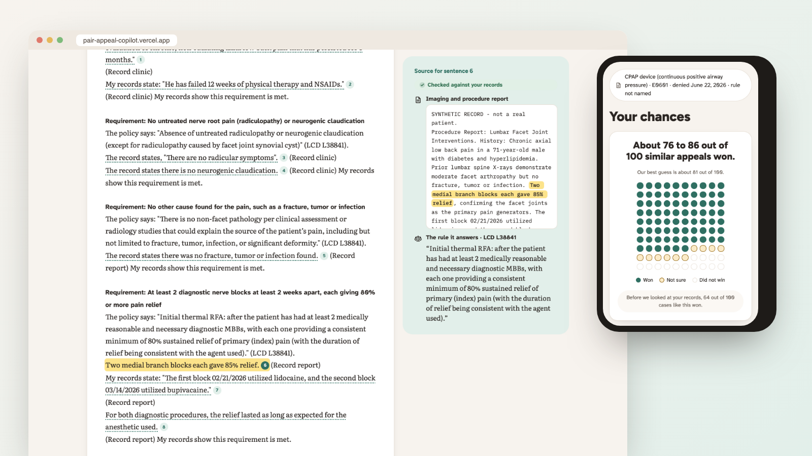
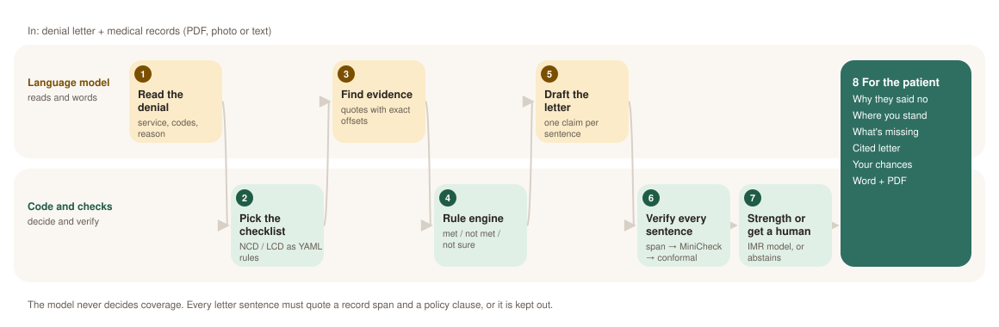
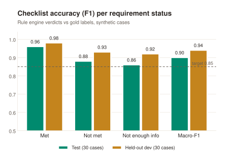
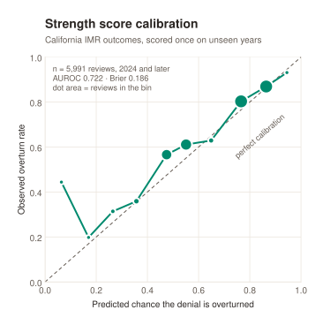
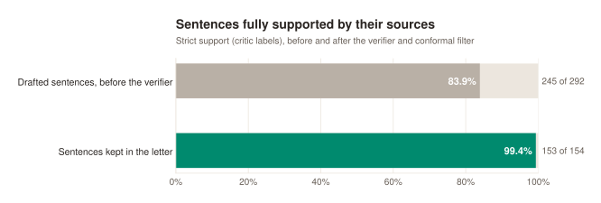
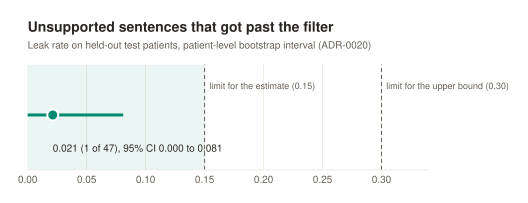
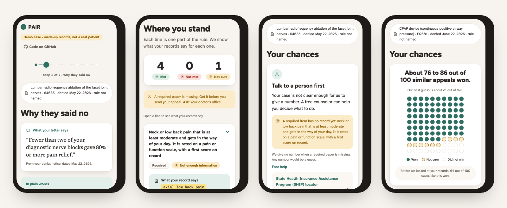

# PAIR: Appeal Copilot

[](https://pair-appeal-copilot.vercel.app)


[](LICENSE)

PAIR helps a patient or caregiver respond to a Medicare Advantage prior authorization denial. You give it the denial letter and your records. It checks each requirement in the Medicare coverage rule (NCD or LCD) that applies, lists the evidence you still need, and drafts an appeal letter where every sentence quotes the policy clause and the record line it relies on. It also gives a strength estimate with a range, and tells you to talk to a counselor when it isn't sure.

<p align="center">
  <a href="https://pair-appeal-copilot.vercel.app"></a>
</p>

**Try it:** https://pair-appeal-copilot.vercel.app (four made-up demo cases; the online copy can't read your own files). Tap any sentence in the letter to see its source.

**Status:** the core engine, the trust layer and the patient demo are built (Phases 2 to 4). Packaging and a fresh-clone `make eval` come next. PAIR is my Build Track entry for UMKC Hack-a-Roo, Fall 2026.

## How it works

The language model only reads and words things. A checklist written as code decides whether each requirement is met, and a verifier checks every sentence in the letter against its sources.

<picture>
  <source media="(prefers-color-scheme: dark)" srcset="docs/img/pipeline-dark.svg">
  
</picture>

| Step | What happens | Who does it |
|---|---|---|
| 1. Read the denial | Pulls the service, codes, denial reason and plan type from the letter | Language model (Gemma 4 E4B, local) |
| 2. Pick the checklist | Matches the service to an NCD or LCD written as YAML rules | Code |
| 3. Find evidence | Quotes record lines for each requirement, with character offsets | Language model via LangExtract |
| 4. Rule engine | Marks each requirement met, not met or not enough information, and lists what's missing | Code |
| 5. Draft the letter | Writes one claim per sentence, each tied to a record span and a policy clause | Language model |
| 6. Verify | Checks the span exists, runs MiniCheck on the claim, then a conformal filter drops weak sentences | Code + Bespoke-MiniCheck-7B |
| 7. Strength | Calibrated range from 42,749 California IMR decisions, or "talk to a person first" | Code (logistic model + Venn-Abers) |

Two terms used below. **F1** is a score from 0 to 1 that balances how often a label is right with how many true cases it finds. **Conformal filtering** sets a cut-off on held-out data so that, by design, only a small share of unsupported sentences can slip through (here the target was at most 15%).

## Results

All numbers come from [RESULTS.md](RESULTS.md) and use synthetic cases only. The charts are drawn by `scripts/readme_figures.py` from those numbers.

| Check | Target | Result |
|---|---|---|
| Denial letter fields read correctly (30 test cases) | ≥ 90% | **100%** |
| Checklist macro-F1 (test / held-out dev) | ≥ 0.85 | **0.90 / 0.94** |
| Extracted evidence that points to a real span in the record | ≥ 95% | **99.5%** |
| Letter sentences supported by their sources, after the verifier | report | **153 of 154 (99.4%)** |
| Unsupported sentences that got past the conformal filter | ≤ 0.15, upper ≤ 0.30 | **0.021** (upper 0.081) |
| Appeal outcome model on 2024+ IMR decisions | report | AUROC 0.722, Brier 0.186 |
| One demo case, end to end, on a MacBook Air M2 | report | 15.3 s |

<table>
<tr>
<td width="50%">
<picture>
  <source media="(prefers-color-scheme: dark)" srcset="docs/img/f1-dark.svg">
  
</picture>
</td>
<td width="50%">
<picture>
  <source media="(prefers-color-scheme: dark)" srcset="docs/img/calibration-dark.svg">
  
</picture>
</td>
</tr>
<tr>
<td>
<picture>
  <source media="(prefers-color-scheme: dark)" srcset="docs/img/verifier-dark.svg">
  
</picture>
</td>
<td>
<picture>
  <source media="(prefers-color-scheme: dark)" srcset="docs/img/leak-dark.svg">
  
</picture>
</td>
</tr>
</table>

What the charts say, in plain words:

- **The checklist is right most of the time, and weakest on "not enough information."** That status is the hardest because it means proving something is absent from the notes.
- **The verifier does real work.** About 1 in 6 drafted sentences wasn't fully supported by its sources. After the filter, 1 kept sentence in 154 wasn't.
- **The strength score tracks reality above 20%.** When it says 80%, about 80% of similar reviews were overturned; in the middle it runs a few points low. Below 20% there are too few cases to say much, which is one reason PAIR abstains on thin evidence.
- **Caveat:** the test and dev cases are synthetic and share 40 Synthea patient profiles. The dev numbers are the cleaner estimate because the test set was used to find bugs.

## What the patient sees

Seven short screens, written at about an 8th grade reading level. Every screen works on a phone and with a keyboard, and passes automated accessibility checks (axe) in light and dark mode.

<p align="center">
  
</p>

1. **Start**: pick a demo case or upload your own files (local only)
2. **Why they said no**: the denial quote and what it means
3. **Where you stand**: each requirement, with the record line that answers it
4. **What's missing**: who to ask for each missing paper
5. **Your letter**: every sentence numbered; tap one to see its record line and policy clause
6. **Your chances**: a range out of 100, or "talk to a person first" with free help links
7. **Download**: Word and PDF, plus a short checklist before you send it

## Quick start

Requires Python 3.11+ and [uv](https://docs.astral.sh/uv/).

```bash
make setup   # install the pinned environment
make test    # run the tests with coverage
make help    # list all targets
```

To run the demo on your own machine (Node 24): `make demo-fixture` publishes a one-case synthetic demo, and `make demo` serves it at http://127.0.0.1:3000. Checking your own files needs `make api` with `PAIR_LIVE=1` and an Ollama model; see `make help` and [ADR-0023](docs/decisions/0023-phase-4-nextjs-demo-and-deps.md).

## Data and privacy

PAIR is built and tested on synthetic patients only. No real patient data goes into this repository, its tests or its logs. Downloaded datasets live under `data/`, which is gitignored. `make data` fetches:

- **CMS Medicare Coverage Database** exports (NCDs and LCDs). Policy clauses in `policies/*.yaml` are quoted from them word for word, and a test checks every quote against the download.
- **California DMHC Independent Medical Review determinations** (42,749 decisions since 2001), used for historical appeal base rates. These are California commercial-plan reviews, not Medicare. See `docs/data/imr-schema.md`.

## Current policy coverage

| Policy | Sources | What is modeled |
|---|---|---|
| PAP devices for sleep apnea | NCD 240.4, LCD L33718 | E0601 initial coverage and continued use (adherence, re-evaluation) |
| Home oxygen | NCD 240.2, LCD L33797 | Group I testing at rest and Group II; not sleep or exercise testing, not Group III |
| Facet joint interventions | LCD L38841 (WPS) | General indications and the diagnostic-block requirement before initial RFA |

### Known limits

The Step 7 rule review ([docs/audit/rule-review.md](docs/audit/rule-review.md), [ADR-0015](docs/decisions/0015-rule-review-changes.md)) left these out of the rules on purpose:

- **PAP:** a re-evaluation after day 91 counts, but coverage restarts only from that visit's date; PAIR says so in the criterion text and doesn't compute the gap. The 120-day deadline for an E0470 swap, the trial pause for a hospital or nursing-facility stay, and whether the face-to-face evaluation before the sleep test or the re-evaluation was in person, with the treating practitioner, aren't modeled. PAIR checks only their dates.
- **Facet joint:** PAIR doesn't check that the same pain scale was used at baseline, after each diagnostic block and at each follow-up (L38841 footnote). Blocks less than 2 weeks apart come out unmet even when the record documents the clinical exception the LCD allows.

### Interpretations

The policy text doesn't settle these points, so PAIR picks a reading. Each one is PAIR's choice, not CMS guidance:

- **Facet "moderate" pain:** L38841 gives no number. PAIR treats a pain score of 4 or more out of 10, or a verbal "moderate" or "severe" rating, as moderate to severe. Boonstra et al. 2014 put the start of "moderate" at 3.5, so a score of 3.5 comes out unmet under PAIR's cut-off.
- **PAP re-evaluation window:** L33718 says "no sooner than the 31st day but no later than the 91st day" without saying how to count. PAIR counts the start date as day 1, so the visit must be at least 30 days after the start.
- **Facet baseline disability scale and sustained relief:** PAIR requires a baseline disability scale and block relief that lasted as long as the agent should. Both follow the LCD's wording, but notes rarely state them, so many facet records come out insufficient. The two Step 7 critics read the baseline disability requirement differently; PAIR applies it because every facet request it handles is for treatment.

### Strength score

The appeal strength starts from California independent medical review (IMR) outcomes for commercial health plans, then moves by assumed odds shifts per requirement (`src/pair/score/adjustments.yaml`). Its coverage numbers are measured on IMR outcomes and are not a guarantee for Medicare Advantage appeals. When a policy has too few similar past reviews, a required record is missing, or neither blood-gas group is shown for home oxygen, PAIR says "get a human" and links to SHIP instead of giving a number (ADR-0019). The model and training window were chosen on 2023 data and reuse those 2023 rows for calibration; with 6 candidates and 2,246 rows the effect is small.

## Not legal or medical advice

PAIR is a research prototype. Review any letter it drafts before sending it, and contact your State Health Insurance Assistance Program (SHIP) for free help with an appeal.

## License

PAIR's code is MIT licensed (see `LICENSE`). Third-party data and models carry their own terms:

- MCD exports: LCD text can reference CPT codes, which are AMA copyright. PAIR quotes coverage text only and doesn't redistribute CPT descriptors.
- IMR data: used for noncommercial research and never redistributed. [TODO: quote the CHHS portal terms]
- Bespoke-MiniCheck-7B (the claim verifier, ADR-0018): licensed CC BY-NC 4.0, so PAIR's verifier setup is for research and demos only, not commercial use. PAIR calls it through Ollama and doesn't redistribute the weights.

Thanks to [Fight Health Insurance](https://github.com/fighthealthinsurance/fighthealthinsurance) (Apache 2.0), whose open IMR work showed this dataset's value for appeals. PAIR's loaders are written separately.
