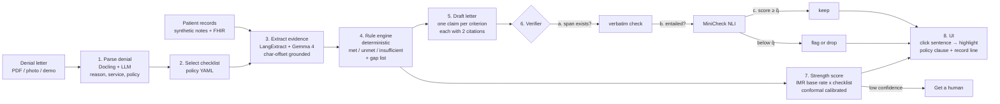
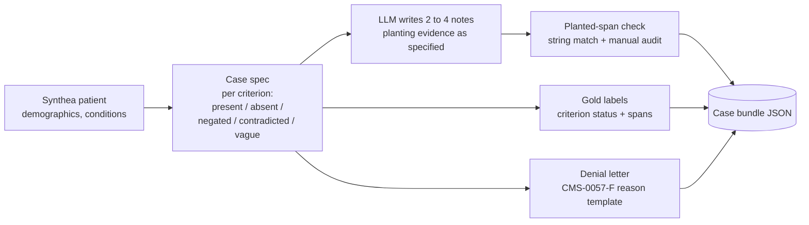
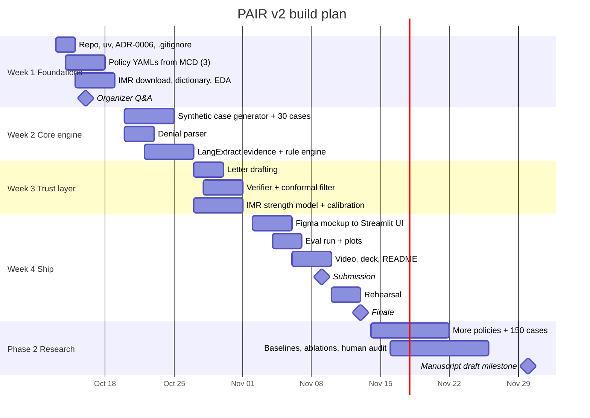

# PAIR v2: Appeal Copilot. Requirements Analysis

_Prior Authorization Intelligence & Reasoning, patient-side edition_
_Version 1.0 · 2026-10-13 · Owner: Nithin Reddy · Mentor: Dr. Uddin_
_Status: approved for build. Supersedes the payer-side framing of `PA-AI-Project-Blueprint-v2.md` and `PA-AI-Insurance-Companion.md` (both frozen). Decision record: ADR-0006._

---

## 0. TL;DR

**One-liner.** Upload a prior authorization denial. In under a minute, PAIR tells you which coverage rules you meet, what evidence is missing, and drafts an appeal where every sentence cites the exact Medicare policy clause and the exact line of the medical record behind it. It also gives a calibrated strength estimate and says "get a human" when it isn't sure.

**Core design rule.** The language model reads but never decides. The decision path is set by coverage rules written as an executable checklist. The LLM only finds evidence for each item. A layered verifier checks every generated sentence against its source before anyone sees it.

**Two phases.**

| Phase | Window | Goal | Size |
|---|---|---|---|
| 1. Hackathon MVP | 2026-10-13 to 2026-11-09 (finale 2026-11-13) | Working demo for Hack-a-Roo Build Track | ~40 h, 3 policies, ~30 synthetic cases, IMR strength model |
| 2. Research extension | 2026-11-14 to 2026-11-30 (internal manuscript milestone), then AMIA 2027 | Paper-grade evaluation | 5+ policies, 150+ cases, baselines, ablations, human audit |

**Scope decisions made 2026-10-13:**
- Primary user is the patient or caregiver. A clinic-staff view is stretch or future work.
- Policy scope is Medicare Advantage denials judged against NCD/LCD criteria. Commercial plans are stretch or future work.
- Add real appeal outcomes from the California DMHC Independent Medical Review (IMR) dataset for the strength score.

---

## 1. Problem and evidence

Prior authorization (PA) is the insurer's permission slip. Before a plan pays for certain drugs, devices, scans or procedures, the clinician must show the patient meets the plan's coverage rules. When the plan says no, the patient appeals, pays out of pocket, or goes without.

**The gap PAIR targets: appeals usually win, yet almost nobody files one.**

| Finding | Number | Data year | Source |
|---|---|---|---|
| Medicare Advantage PA determinations | ~50 million | 2023 | [KFF](https://www.kff.org/f63a430) |
| MA PA denials that were appealed | 11.7% | 2023 | [KFF](https://www.kff.org/f63a430), via [LeadingAge](https://leadingage.org/new-kff-report-more-ma-prior-authorizations-appeals-remain-successful/) |
| MA PA appeals partly or fully overturned | 81.7% | 2023 | [KFF](https://www.kff.org/f63a430) |
| Same, prior year | 9.9% appealed, 83.2% overturned | 2022 | [KFF](https://kff.org/29f980b) |
| HealthCare.gov in-network denied claims appealed | under 0.2% | 2021 | [KFF ACA claims brief](https://www.kff.org/private-insurance/issue-brief/claims-denials-and-appeals-in-aca-marketplace-plans/) |
| MA denials that met Medicare coverage rules (OIG sample of 250 PA denials, 15 largest MAOs) | "sometimes" denied despite meeting rules; see report for rates | 2019 sample | [HHS-OIG OEI-09-18-00260](https://oig.hhs.gov/reports/all/2022/some-medicare-advantage-organization-denials-of-prior-authorization-requests-raise-concerns-about-beneficiary-access-to-medically-necessary-care) |

> **Correction to earlier notes.** The Hack-a-Roo memo and the Insider's Guide quote "67% overturned (KFF, 2025)". The latest KFF figure we could verify is **81.7% (2023 data)**. "Fewer than 1% appeal" comes from ACA Marketplace claims data, not MA. Use the table above in the pitch. The OIG "13%" figure is confirmed (OEI-09-18-00260, page 2: 13 percent of denied prior authorization requests met Medicare coverage rules).

**Why now: three regulatory shifts.**

1. **CMS-0057-F** (Interoperability and Prior Authorization final rule). From 2026-01-01, impacted payers must give a **specific reason** for each denial and decide within 72 hours (expedited) or 7 days (standard). A FHIR PA API is due 2027-01-01. A specific reason is something software can parse and argue against.
2. **CMS-4201-F** (CY2024 MA and Part D final rule). MA plans **must follow NCDs, LCDs and Traditional Medicare coverage rules**. They may use internal criteria only when Medicare criteria are not fully established, and those criteria must be public and evidence-based ([CMS fact sheet](https://www.cms.gov/newsroom/fact-sheets/2024-medicare-advantage-and-part-d-final-rule-cms-4201-f), [King & Spalding summary](https://www.kslaw.com/attachments/000/010/547/original/New_Medicare_Advantage_Regulations_Add_Provider_and_Beneficiary_Protections_Against_Plan_Utilization_Management_Policies.pdf)). **This is PAIR's legal lever.** Citing the LCD against an MA denial is grounded in regulation.
3. **WISeR**, CMS's AI-assisted PA model for Original Medicare. It runs 2026-01-01 to 2031-12-31 in six states (AZ, NJ, OH, OK, TX, WA). GAO decided on 2026-05-12 that its notice is a rule under the Congressional Review Act. On 2026-06-09 the House Appropriations Committee approved an FY2027 rider to defund it, which is still pending ([Georgetown CHIR](https://medicare.chir.georgetown.edu/?p=985), [Polsinelli](https://www.polsinelli.com/health-care/publications/house-panel-moves-to-block-cms-ai-driven-prior-authorization-program-wiser-rider-providers), [LeadingAge](https://leadingage.org/congress-remains-divided-on-wiser-model/)). Payer-side AI is now contested, and patient-side help is the gap.

**Why patients don't appeal.** Writing an appeal means reading dense coverage documents, digging through records, and matching the two line by line. Patients don't know how, and clinic staff don't have the hours. Many people don't know they can appeal at all ([Stateline, 2025](https://stateline.org/2025/11/20/patients-deploy-bots-to-battle-health-insurers-that-deny-care/)).

---

## 2. Users and user stories

### Primary persona: patient or caregiver (Phase 1)

- A Medicare Advantage enrollee, or an adult child helping a parent, who just got a PA denial for a device, test or procedure.
- No clinical or legal training. Has the denial letter and can request records from the doctor's portal.
- Needs plain language, a clear next step, and an honest sense of whether it's worth fighting.

### Secondary persona: clinic staff (stretch or future)

- A PA coordinator or nurse at a small practice.
- Wants clinical vocabulary, batch handling, and a chart-level evidence view. The same engine serves both; only the view changes.

### User stories (Phase 1)

| ID | As a patient I want to... | So that... | Priority |
|---|---|---|---|
| US-1 | upload my denial letter (PDF or photo) or pick a demo case | I don't have to retype anything | Must |
| US-2 | see which coverage rule the denial is about, in plain words | I understand why they said no | Must |
| US-3 | see each rule marked **met / not met / not enough info**, with the record line that shows it | I know where I stand | Must |
| US-4 | get a "what's missing" list ("ask your doctor for your sleep study AHI result") | I can fix gaps before appealing | Must |
| US-5 | get a draft appeal letter where clicking any sentence highlights its policy clause and record line | I can trust and check it | Must |
| US-6 | see an appeal strength estimate with an honest range, and a "get a human" warning when the case is unclear | I don't waste effort or give up too early | Must |
| US-7 | download the letter (DOCX/PDF) | I can send it | Should |
| US-8 | see appeal deadlines and where to send the letter | I don't miss the window | Could |
| US-9 | switch to a clinic view | staff can use the same tool | Won't (Phase 1) |

---

## 3. Scope

### MoSCoW for the 40-hour build

| Must | Should | Could | Won't (now) |
|---|---|---|---|
| 3 policy checklists in YAML | DOCX/PDF export | Appeal deadline helper | Clinic-staff view |
| ~30 synthetic denial cases with gold labels | Figma-designed UI | Gemma 4 26B on lab GPU for quality runs | Commercial plans (InterQual/MCG are proprietary) |
| Denial parsing (reason, service, policy) | Docling OCR for scanned letters | Presidio scrub of free-text uploads | Real PHI of any kind |
| Grounded evidence extraction | MiniCheck NLI layer | Multi-language letters | FHIR/CDS Hooks integration |
| Deterministic rule engine + gap list | IMR argument-pattern exemplars | | Neo4j knowledge graph, Qdrant vector DB |
| Letter drafting, one claim per cited criterion | | | Fine-tuning any model |
| Verifier (span check at minimum) | | | Sending letters to insurers |
| Claim-level conformal filtering | | | |
| IMR-based strength score, calibrated | | | |
| Streamlit demo with click-to-source | | | |
| Metrics: checklist F1, claim funnel, calibration plot | | | |
| 3-minute video + pitch deck | | | |

### Stretch and future list

1. Clinic-staff view (two views, one engine).
2. Commercial plans that publish their criteria.
3. Later Medicare appeal levels (reconsideration, ALJ) and their templates.
4. Da Vinci PAS / FHIR PA API once payers expose it (2027).
5. Voice or phone agent for calling the plan (Counterforce does this).

---

## 4. System architecture



**Only step 3 uses an LLM's judgment** (and step 5 for wording). Steps 2, 4 and 6 box it in on both sides. Step 1 uses an LLM only to fill a fixed schema.

### Component contracts

| # | Component | Input | Output | Notes |
|---|---|---|---|---|
| 1 | `ingest.denial` | PDF/image/text | `Denial{service, codes, reason_text, reason_category, policy_ref, plan_type, date}` | Docling for OCR/layout; LLM fills a Pydantic schema. CMS-0057-F reason categories. |
| 2 | `policies` | `policy_ref` or service code | `Checklist{criteria[], logic}` | YAML per policy, loaded and validated at startup |
| 3 | `extract` | notes + criterion list | `Evidence{criterion_id, value, span_text, char_start, char_end, doc_id, status}` | LangExtract; drop extractions with `char_interval=None` |
| 4 | `rules` | checklist + evidence | `Verdict{per_criterion: met/unmet/insufficient, overall, gaps[]}` | Pure Python, no LLM, unit-tested per policy |
| 5 | `draft` | verdict + evidence + denial | `Letter{claims[{text, policy_cite, evidence_cite}]}` | One claim per quote; template skeleton + LLM wording |
| 6 | `verify` | each claim + its sources | `claim.score, claim.decision` | Span check, then NLI, then conformal threshold |
| 7 | `score` | denial features + verdict | `Strength{p, interval, abstain}` | IMR model + checklist completeness |
| 8 | `ui` | everything | Streamlit app | Highlight-to-source from char offsets |

### Policy checklist format (example)

```yaml
id: pap-osa
title: Positive Airway Pressure (PAP) Devices for Obstructive Sleep Apnea
sources:
  - {type: NCD, id: "240.4", url: "<MCD link>"}
  - {type: LCD, id: "L33718", url: "<MCD link>"}   # verify ID in MCD
criteria:
  - id: f2f_visit
    text: "Face-to-face clinical evaluation before the sleep test"
    clause: "<verbatim LCD text>"
    evidence_type: encounter
  - id: ahi_threshold
    text: "AHI/RDI >= 15, or 5 to 14 with qualifying symptoms or comorbidity"
    clause: "<verbatim LCD text>"
    evidence_type: lab_value
    rule: "ahi >= 15 or (5 <= ahi <= 14 and any(symptoms_or_comorbidity))"
  - id: adherence
    text: ">= 4 hours/night on >= 70% of nights in a 30-day window during trial"
    clause: "<verbatim LCD text>"
    evidence_type: device_report
logic: "f2f_visit and ahi_threshold and (initial or adherence)"
```

---

## 5. Data

### 5.1 Data sources overview

| Source | What | Role in PAIR | Access | License / limits |
|---|---|---|---|---|
| CMS Medicare Coverage Database (MCD) | NCDs, LCDs, articles as CSV/MDB + Coverage API | Policy text for checklists and citations | [Downloads](https://cms.gov/outreach-and-education/mln/educational-tools/mln901347-how-to-mcd/mcd/mcd/chapter_6_downloads); [Coverage API](https://api.coverage.cms.gov/docs/release_notes) (license token, 1-hour validity) | Accept AMA/ADA/NUBC license; don't redistribute CPT text |
| Synthea | Synthetic FHIR patients | Demographics, conditions, meds, encounters for cases | Open source | Apache 2.0 |
| LLM-generated clinical notes | Notes with planted evidence | The text PAIR extracts from; gold labels by construction | We generate | Ours; mark as synthetic |
| Synthetic denial letters | Letters using CMS-0057-F specific reasons | Input to step 1 | We write from templates | Ours |
| **CA DMHC IMR determinations** | Every IMR decision since 2001 (upheld/overturned, diagnosis category, treatment category, review type, findings summary) | Real outcome labels for the strength score; argument patterns | [CHHS Open Data](https://data.chhs.ca.gov/dataset/independent-medical-review-imr-determinations-trend), [CSV](https://data.chhs.ca.gov/dataset/b79b3447-4c10-4ae6-84e2-1076f83bb24e/resource/3340c5d7-4054-4d03-90e0-5f44290ed095/download/independent-medical-review-imr-determinations-trends.csv), last updated 2026-06-01 | Noncommercial use OK; no altered redistribution. **Commit a download script, never the data.** |
| NY DFS external appeal decisions | Case summary pages | Phase 2 cross-state validation (scrape carefully) | [DFS public appeals](https://www.dfs.ny.gov/public-appeals/case-number-202002-126087) | No bulk export confirmed |
| HHS-OIG OEI-09-18-00260 | Audit of 250 MA PA denials | Denial-reason taxonomy, motivation | [PDF](https://www.oversight.gov/sites/default/files/oig-reports/HHSOIG/OEI-09-18-00260.pdf) | Public |

### 5.2 Policies (Phase 1: three)

Criteria for picking policies: (a) applies to MA through CMS-4201-F, (b) mostly numeric or checkable criteria, (c) a common denial category, (d) cleanly synthesizable evidence.

| Policy | Coverage docs (verify IDs in MCD) | Why it fits | Key checkable criteria |
|---|---|---|---|
| PAP devices for obstructive sleep apnea | NCD 240.4 + LCD L33718 | Numeric thresholds, very common DME denial | Face-to-face visit; AHI/RDI ≥15, or 5 to 14 with symptoms/comorbidity; ≥4 h/night on ≥70% of nights in 30 days ([CGS](https://www.CGSMedicare.com/jc/dpl/dpl_pap_devices_initial_qual.pdf), [CMS reason codes](https://www.cms.gov/files/document/esmd-continuous-positive-airway-pressure-cpap-reason-codes-and-statements.pdf)) |
| Home oxygen | NCD 240.2 + LCD L33797 | Numeric SpO2/PaO2 thresholds, testing conditions | Qualifying blood gas/saturation, test timing, condition, treating practitioner eval |
| Facet joint interventions | MAC-specific LCD (pick one MAC, find the ID) | Procedure with step-therapy criteria; tests the "insufficient" path | Pain duration ≥3 months, failed conservative therapy, functional impact, diagnostic block relief threshold |

Phase 2 candidates: lumbar MRI/advanced imaging, inpatient rehab facility criteria (Benefit Policy Manual), GLP-1 or another Part D drug (needs plan formulary criteria).

### 5.3 Synthetic cases by evidence planting

We plant each criterion's evidence in a known state, which gives gold labels for free.



Case types, balanced per policy:

| Type | Ground truth | What the demo should show |
|---|---|---|
| A. Wrongly denied | All criteria met in records | Strong appeal, high strength |
| B. Fixable gap | One or more criteria "insufficient" (e.g., AHI test exists but not in records) | Gap list: "ask your doctor for X"; medium strength |
| C. Correctly denied | A criterion clearly not met | Honest "appeal unlikely"; suggest alternatives |
| D. Tricky | Negation ("denies daytime sleepiness"), contradiction, or out-of-window dates | Tests the extractor and verifier |

Sizes: Phase 1 has 30 cases (10 per policy). Phase 2 has 150+. 20% of cases are hand-audited for realism and label correctness.

### 5.4 IMR dataset plan

- **Download and data dictionary first.** Confirm the real column names before any code; the third-party listings disagree.
- **Label:** overturned = 1, upheld = 0.
- **Features (pre-decision only):** diagnosis category and subcategory, treatment category and subcategory, IMR type (medical necessity / experimental-investigational / urgent care), age range, gender, year.
- **Leakage rule:** the findings text is written after the decision, so it is **never a model feature**. It's used only (a) to mine common winning arguments per treatment category, used as few-shot exemplars for drafting, and (b) for qualitative analysis.
- **Split by time:** train on ≤2022, calibrate on 2023, test on 2024 onward. This mimics deployment drift.
- **Mapping PAIR cases to IMR categories:** a small hand table, e.g., PAP to "DME" / "sleep disorders".
- **Honest framing in the UI:** "Of N similar disputes reviewed independently in California, X% were overturned." This is a historical base rate, not a promise. Medicare is a different system.
- **Reuse check:** Fight Health Insurance (open source) already processes IMR data. Check its repo license and `dataset_tools` before writing our own loaders ([ZenML writeup](https://www.zenml.io/llmops-database/using-llms-to-combat-health-insurance-claim-denials)).

### 5.5 Data rules

- No real PHI anywhere: code, tests, screenshots, chats, demo.
- `data/raw/`, `data/interim/` and IMR files are gitignored. Only download scripts and synthetic generators are committed.
- Every synthetic artifact carries `"synthetic": true` and the generator seed.
- Uploaded files in the demo stay in memory. They are scrubbed with Presidio if logged, and never persisted.

---

## 6. Methods

Each method below lists what it is in plain words, then how PAIR uses it.

### 6.1 Policy as executable checklist (neuro-symbolic split)
**Plain words:** write the coverage rules as code, so the decision is a traceable function and not an LLM opinion.
**In PAIR:** YAML criteria plus a Python rule per criterion. The LLM's only output is the evidence with its location, and the rule engine decides met/unmet/insufficient. Close prior art is AGVF ([arXiv 2609.27844](https://arxiv.org/html/2609.27844)), which uses Boolean policy constraint graphs; see section 9.

### 6.2 Grounded extraction
**Plain words:** every fact the model pulls out must point to the exact characters it came from.
**In PAIR:** [LangExtract](https://developers.googleblog.com/en/introducing-langextract-a-gemini-powered-information-extraction-library/) with few-shot examples per criterion type. It runs on Ollama (Gemma 4) or Gemini. Extractions without a source interval are dropped, which is a free hallucination filter. The character offsets also power UI highlighting.

### 6.3 Claim decomposition: one claim, one quote
**Plain words:** each sentence in the letter makes one point, backed by one policy quote and one record quote.
**Why:** the claim funnel study ([arXiv 2609.15964](https://arxiv.org/abs/2609.15964)) found that verbatim quoting is nearly solved, while full support is not. One model quoted verbatim 98% of the time, but only 37% of its claims were strictly supported. Multi-detail claims are where support breaks, so we keep claims atomic.

### 6.4 Layered verifier
1. **Span check** (deterministic): does the quoted text exist verbatim in the cited source?
2. **Entailment** (NLI): does the quote actually support the claim? We use [Bespoke-MiniCheck-7B](https://bespokelabs.ai/bespoke-minicheck), which reports 77.4% on LLM-AggreFact vs 71.8% for HHEM-2.1 (vendor-reported). It's available on Ollama. On the laptop, a smaller MiniCheck variant or Gemini-as-judge is the fallback.
3. **Conformal threshold** (6.5): keep, flag, or drop.

### 6.5 Conformal claim filtering
**Plain words:** choose the cut-off on verifier scores using held-out examples, so that, on average over calibration sets, a new unsupported claim gets through the filter at most α of the time (the leak rate), with a guarantee that doesn't depend on the model being well calibrated. This bounds how many bad claims get through; it does not promise that a share of kept claims is supported, which is reported separately as a description. Decided in [ADR-0020](decisions/0020-claim-labels-and-conformal-split.md), which supersedes the earlier "kept claims are wrong at most α" wording and sets the exit rule.
**In PAIR:** split conformal in the style of conformal factuality (Mohri & Hashimoto 2024) on claim-level verifier scores. A calibration set of labeled claims comes from the synthetic cases. Expected counts are in [ADR-0020](decisions/0020-claim-labels-and-conformal-split.md) (about 100 to 270 claims per side from the Phase 2 verdicts, with very few unsupported ones), and [ADR-0021](decisions/0021-pilot-sized-patient-pools.md) sizes extra patient pools from a dev-only pilot.
**Pitfall to avoid** ([arXiv 2609.38222](https://arxiv.org/abs/2609.38222)): when filtering empties a response, the guarantee holds trivially. We always report **empty-letter rate** and **support rate among non-empty outputs**, not just the headline coverage.

### 6.6 Strength score with calibrated uncertainty
**Plain words:** a number for "how likely is this appeal to win", honest about its range, which abstains when unsure.
**In PAIR:**
- Base model: gradient-boosted classifier (LightGBM) or logistic regression on IMR features.
- Calibration: Mondrian (category-conditional) conformal or Venn-Abers, so each treatment category gets its own valid interval.
- Combination with the checklist (decided in ADR-0007): convert the IMR base rate for the category to odds, multiply by a documented shift per checklist outcome (all met / insufficient / clearly unmet), and convert back, shown as a range. Shift sizes live in `score/adjustments.yaml` with a written rationale and are labeled as assumptions; Phase 2 research tests how sensitive results are to them.
- Explanation shown to the patient: how (base rate → each adjustment → final estimate), why (each step names its criterion and record line), and what helps (each insufficient item re-scored as met; no "raise your odds" path for clearly unmet items).
- Contract: `Strength{p, interval, abstain, abstain_reason, explanation{base_rate, n_similar, imr_category, steps[{criterion_id, status, shift, why}], improve[{criterion_id, action, p_if_fixed}]}}`.
- Abstain ("get a human") when the interval is too wide or the checklist has "insufficient" items on critical criteria.

### 6.7 Gap analysis
**Plain words:** list what's missing and who can provide it.
**In PAIR:** for each unmet or insufficient criterion, a plain-language request is generated from a template, e.g., "Ask Dr. X's office for your home sleep test report showing the AHI number." The provider-side PAVE-1 pilot validates the value of pre-submission gap flagging (JMCP 2026).

---

## 7. Tech stack

| Layer | Choice | Why | Alternatives / notes |
|---|---|---|---|
| Language, env | Python 3.11+, `uv` | User standard; fast, reproducible | |
| Local LLM | **Gemma 4 E4B** via Ollama (laptop) | Fits 8 GB M2; good structured output (ADR-0003) | Gemma 4 E2B if memory-tight |
| Larger local LLM | Gemma 4 26B MoE or 12B via Ollama/vLLM on lab server (4× A4000, 16 GB each) | Quality runs, eval sweeps | 31B dense needs 2 cards at 4-bit |
| Cloud LLM | Gemini Flash on Vertex AI (**$50/yr GenAI credit**) | Batch generation of synthetic notes, judge runs | **Set thinking budget to 0** on extraction calls (triage-bot cost lesson) |
| Grounded extraction | **LangExtract** | Char-offset grounding, Ollama + Gemini support, HTML review viewer | MedSpaCy/scispaCy only if negation handling needs ConText |
| Schemas | Pydantic v2 | Typed contracts between components | |
| Document parsing | **Docling** (MIT) for uploaded denial PDFs/scans | OCR + layout, local | Marker (GPL-3.0, better on GPU) |
| Policy data | MCD CSV downloads + Coverage API | Structured, no PDF parsing needed | |
| Rule engine | Plain Python + YAML | Deterministic, readable, testable | json-logic if rules grow |
| Verifier | Span match + **Bespoke-MiniCheck-7B** (Ollama) | Top open grounding checker; CC BY-NC is fine for research | AlignScore, HHEM-2.1, LLM judge |
| Conformal | Hand-rolled split conformal (~30 lines) + **MAPIE** or **crepes** (Venn-Abers) | Simple, auditable | |
| Strength model | scikit-learn, LightGBM | Tabular, fast | |
| Privacy | Microsoft Presidio | Scrub any free-text upload before logging | |
| Synthetic patients | Synthea | Realistic FHIR bundles | |
| UI | **Streamlit**, designed in Figma first | Fast to build; polished on stage (ADR-0004) | Next.js landing page later |
| Export | python-docx, WeasyPrint | Letter download | |
| Testing | pytest, pytest-cov | 80% coverage target on `rules/`, `verify/`, `score/` | |
| Packaging | Docker + docker compose (one service at a time) | One-command run | |
| Experiment tracking | JSONL run logs + `RESULTS.md` | Lightweight | MLflow only if Phase 2 needs it |

**Dropped from v1 and why** (see ADR-0006):
- **Neo4j:** three policies don't need a graph; YAML is easier to audit.
- **Qdrant:** per-case records are small enough for in-context extraction.
- **CDS Hooks:** a patient-facing tool has no EHR hook point.

All three remain options for Phase 2+ if policy count grows.

### Hardware plan

| Machine | Use | Rule |
|---|---|---|
| MacBook Air M2, 8 GB | Dev + live demo (Gemma 4 E4B, Streamlit) | One heavy service at a time; cached demo runs as backup |
| Lab GPU server, 4× A4000 | MiniCheck-7B, Gemma 26B, eval sweeps | tmux, `nvidia-smi` before runs, results pushed to git |
| Vertex AI | Synthetic note generation, judge runs | Watch the $50 credit; thinking off |

---

## 8. Evaluation plan

### 8.1 Metrics

| Component | Metric | Target (Phase 1) | Data |
|---|---|---|---|
| Denial parsing | Field accuracy (service, reason category, policy) | ≥90% | 30 synthetic letters |
| Evidence extraction + rules | Per-criterion macro-F1 (met / unmet / insufficient) | ≥0.85 | Gold labels from planting |
| Grounding | % extractions with valid char interval | ≥95% | Same |
| Letter citations | **Claim funnel**: coverage → verbatim → lenient support → strict support (CCR) | CCR ≥80% after verifier | Claims from all cases; adversarial critic (ADR-0013) + human audit |
| Conformal filter | Leak rate vs α = 0.1; empty-letter rate; support among non-empty; precision of kept claims | Pass only if n ≥ 30 unsupported test claims, leak point ≤ 0.15 and cluster-bootstrap upper ≤ 0.30, else "inconclusive" (ADR-0020, ADR-0021) | Calibration/test split of claims by patient |
| Strength score | AUROC, Brier, reliability diagram, interval coverage | Coverage within ±3 pts of nominal | IMR test years (2024+) |
| System | End-to-end latency on M2 | <60 s per case | Demo cases |
| Human | 50-claim audit: supported / partly / unsupported | Agreement with the critic ≥85%, plus Cohen's kappa (ADR-0013) | Random sample, audited by Nithin |

### 8.2 Baselines and ablations (Phase 2 must, Phase 1 if time)

| Run | What changes | Question it answers |
|---|---|---|
| B1. Single-prompt LLM | "Write an appeal for this denial + records" | How bad is the naive approach? |
| B2. Plain RAG | Retrieve policy chunks + notes, generate | Does structure beat retrieval alone? |
| A1. No verifier | Skip step 6 | What does verification buy? |
| A2. No gate (AGVF-style) | Allow uncited claims | Direct comparison to AGVF's ablation |
| A3. No conformal | Fixed 0.5 threshold | Does calibration matter? |
| A4. Model swap | Gemma E4B vs 26B vs Gemini Flash | Cost/quality trade-off |

### 8.3 Visuals to produce

- Claim funnel bar chart (per system).
- Reliability diagram for the strength score.
- Coverage vs abstention curve across α.
- Per-criterion confusion matrices.
- One consistent color palette across all plots.

---

## 9. Prior art and positioning

| Work | Side | Real policies | Real LLM | Verifier | Calibrated confidence | Open source | Gap PAIR fills |
|---|---|---|---|---|---|---|---|
| **AGVF** ([arXiv 2609.27844](https://arxiv.org/html/2609.27844), 2026) | Provider appeals | Hand-authored synthetic policy graphs | Mock LLM | Deterministic citation gate (admissibility only) | No | On request | Real LLM, real CMS policies, semantic verifier, conformal, real outcomes |
| AI-generated PA letters ([arXiv 2603.29366](https://arxiv.org/pdf/2603.29366), 2026) | Provider PA requests | Scenario-based | GPT/Claude/etc. | Rubric scoring | No | No | Post-denial, patient-facing, claim-level verification |
| LLM radiotherapy appeals ([JCO CCI 2024](https://ascopubs.org/doi/10.1200/CCI.24.00129)) | Provider appeals | Literature | GPT-3.5/4 | Human raters | No | No | Found LLMs poor at citing support; fine-tuning increased confabulation. Motivates our verifier. |
| Fight Health Insurance ([ZenML](https://www.zenml.io/llmops-database/using-llms-to-combat-health-insurance-claim-denials)) | Patient | IMR-trained | Fine-tuned open model | Not advertised | No | Yes | Clause-level citations, calibrated strength |
| Counterforce Health ([Stateline](https://stateline.org/2025/11/20/patients-deploy-bots-to-battle-health-insurers-that-deny-care/)) | Patient, free nonprofit | Plan policy + research | Yes | Not advertised | No | No | Verifiable citations, calibrated confidence, local/private |
| Claimable | Patient, ~$40/letter | Laws, precedents, literature | Yes | Not advertised | No | No | Same |
| PAVE-1 (JMCP 2026) | Provider, pre-submission | Payer criteria | NLP + EHR | Pharmacist review | Approval likelihood | No | Patient side, post-denial, open |
| KREL ([arXiv 2608.20887](https://arxiv.org/abs/2608.20887)) | Medical coding | ICD guidelines | Yes | LLM verifier vs guidelines | No | n/a | Pattern source for extract-then-verify |
| Claim funnel ([arXiv 2609.15964](https://arxiv.org/abs/2609.15964)) | Clinical QA eval | AHA/ADA guidelines | 12 LLMs | Strict support judge | No | n/a | We adopt the metric |
| Conformal factuality, multi-hop RAG ([arXiv 2609.38222](https://arxiv.org/abs/2609.38222)) | General RAG | n/a | Llama 3.1 8B, GPT-4o-mini | Claim filter | Yes | n/a | We adopt the method plus its reporting caveat |

**PAIR's claim in one sentence:** the first open, patient-facing appeal assistant where coverage logic is deterministic, every sentence is verified against both the policy clause and the record line, and both claim reliability and appeal strength carry distribution-free guarantees.

---

## 10. Non-functional requirements

| Area | Requirement |
|---|---|
| Privacy | No real PHI. Uploads processed in memory, never stored. Local-first by default; cloud LLM only on synthetic data. |
| Safety | Every letter carries a "not legal or medical advice; review before sending" notice. Low-confidence cases route to "get a human" with links to SHIP (State Health Insurance Assistance Program) counselors. |
| Honesty | Strength shown as a range with its data source. UI copy never promises an outcome. |
| Performance | <60 s per case on M2 8 GB; demo uses cached runs as a fallback. |
| Resources | Max one heavy service (Ollama or Docker) at a time on the laptop. |
| Reproducibility | Pinned `uv.lock`, seeds on all generators, every eval run logged with config hash. |
| Explainability | Every claim links to its policy clause and record span; the rule trace is viewable per criterion. |
| Accessibility | Plain language (target grade 8 reading level for patient text), keyboard navigable, color not the only status signal. |
| Licensing | MIT for PAIR code. Third-party limits documented: IMR noncommercial, MiniCheck CC BY-NC, MCD AMA/CPT terms. |
| Docs | README with demo GIF, architecture diagram, honest limitations section. ADR for every stack or scope change. |

---

## 11. Repository layout

```
PAIR/
├── README.md                     # portfolio front door
├── LICENSE                       # MIT
├── pyproject.toml / uv.lock
├── docker-compose.yml
├── Makefile                      # make setup | data | demo | eval | test
├── docs/
│   ├── PAIR-v2-requirements.md   # this doc
│   ├── baseline-v1/              # frozen v1 docs (moved, unedited)
│   └── figures/
├── policies/                     # pap-osa.yaml, home-oxygen.yaml, facet-joint.yaml
├── scripts/
│   ├── download_imr.py
│   ├── download_mcd.py
│   └── generate_cases.py
├── data/                         # gitignored (raw/, interim/, cases/)
├── src/pair/
│   ├── ingest/      # denial parsing
│   ├── policies/    # YAML loader + schema
│   ├── extract/     # LangExtract wrappers, few-shot examples
│   ├── rules/       # deterministic engine + gap list
│   ├── draft/       # letter templates + LLM wording
│   ├── verify/      # span check, NLI, conformal
│   ├── score/       # IMR model + calibration
│   ├── ui/          # Streamlit app
│   └── eval/        # metrics, funnel, plots
├── tests/
└── notebooks/                    # EDA only, outputs stripped
```

Public-repo hygiene: no agent files (`CLAUDE.md`, `.claude/`) committed, no AI attribution in commits, `.gitignore` written before the first data download.

---

## 12. Timeline



**Hour budget (Phase 1, ~40 h):** foundations 8, core engine 12, trust layer 10, ship 10.

**Cut order if behind schedule:** facet-joint policy → MiniCheck (span check only) → DOCX export → Figma polish. **Never cut:** verifier span check, gap list, strength score with abstain.

---

## 13. Risks and mitigations

| Risk | Likelihood | Impact | Mitigation |
|---|---|---|---|
| Gemma 4 E4B extraction too weak | Medium | High | Few-shot per criterion; fall back to Gemini Flash; 26B on lab server for evals |
| Conformal on small data is meaningless | Medium | Medium | Calibrate at the claim level (hundreds of claims); report intervals and n honestly |
| IMR is California commercial, not Medicare | Certain | Medium | Present as "historical base rate for similar independent reviews"; Mondrian by category; Phase 2 adds NY DFS |
| IMR columns differ from what listings claim | Medium | Low | Read the data dictionary before coding |
| Synthetic notes too clean | High | Medium | Plant negations, contradictions, vague mentions; hand-audit 20% |
| LCD IDs differ by MAC or are retired | Medium | Low | Verify each in MCD in week 1; store retrieval date |
| License limits (IMR noncommercial, MiniCheck CC BY-NC, CPT text) | Certain | Low (research) | Document in README; no commercial claims |
| Prior art (AGVF) seen as same idea | Medium | Medium | Lead with real-LLM, real-policy evaluation and conformal guarantees; cite it openly |
| Scope creep | High | High | MoSCoW above; ADR for any scope change |
| Live demo crashes (8 GB laptop) | Medium | High | Cached runs, recorded video, one service at a time |
| Vertex credit runs out | Low | Medium | Thinking budget 0; batch only; local fallback |
| Hackathon rule on pre-existing work | Low | High | Repo has docs only, no code; confirm at 2026-10-16 Q&A that public datasets are allowed |

---

## 14. New suggestions from this research (for discussion)

| # | Suggestion | Recommendation | Status |
|---|---|---|---|
| 1 | Use CA DMHC IMR real outcomes for the strength score | Adopt | **Accepted 2026-10-13** |
| 2 | "What's missing" gap checklist as a headline patient feature | Adopt; strongest demo moment | Proposed |
| 3 | Claim funnel (coverage → verbatim → lenient → strict) as the main citation metric | Adopt | Proposed |
| 4 | LangExtract instead of MedSpaCy as the extractor | Adopt; offsets give highlighting free | Proposed |
| 5 | Layered verifier: span → NLI → conformal | Adopt; span check is the must-have floor | Proposed |
| 6 | Always report abstention and non-empty reliability with conformal results | Adopt | Proposed |
| 7 | Fix pitch stats (81.7% / 11.7%, KFF 2023 data) | Adopt; also fix the Insider's Guide | Proposed |
| 8 | Reuse Fight Health Insurance's IMR tooling if the license allows | Check first | Open |
| 9 | Policy text from MCD CSV, not PDFs | Adopt | Proposed |
| 10 | Gemini thinking budget 0 on all extraction calls | Adopt | Proposed |
| 11 | Copy AGVF's "no gate" ablation for direct comparison | Adopt in Phase 2 | Proposed |
| 12 | Plain-language reading-level check on patient-facing text | Could | Proposed |

---

## 15. Open questions

1. ~~Exact LCD IDs and current text for the three policies (verify in MCD, week 1).~~ Answered 2026-10-15 from the MCD export dated 2026-10-12: NCD 240.4 v3 + LCD L33718 v52 (PAP), NCD 240.2 v2 + LCD L33797 v50 (home oxygen), and WPS LCD L38841 v20 for facet joints. Clauses are quoted verbatim in `policies/*.yaml`, and a test checks them against the export.
2. ~~IMR data dictionary: actual column names and row count.~~ Answered 2026-10-15: 42,749 rows, 14 columns, report years 2001 to 2026, 52.5% overturned. The portal's dictionary (2020) is stale; the real columns, roles and leakage rules are in `docs/data/imr-schema.md`. The "IMR type" in §5.4 is the `Type` column; `IMRType` is Standard vs Expedited. `DaysToReview` and `DaysToAdopt` are post-decision and excluded from features.
3. ~~Fight Health Insurance repo license and reusable IMR tools.~~ Answered 2026-10-15: mostly Apache 2.0 (some subfolders carry their own licenses). Its IMR ingest is tied to Django models and there is no `dataset_tools`, so PAIR uses its own small loader and copies no code.
4. Hack-a-Roo rules: confirm public datasets and pre-written docs are fine (2026-10-16 Q&A).
5. Dr. Uddin: confirm the mentor role and agreement on AMIA 2027 framing.
6. ~~Strength-score combination: how to merge the IMR base rate with checklist completeness (simple Bayes-style adjustment vs a small learned model on synthetic cases).~~ Decided 2026-10-15: Bayes-style adjustment plus an explanation panel. See ADR-0007.
7. ~~Confirm the OIG report's denial-rate figure from the PDF before citing a number.~~ Answered 2026-10-15 from OEI-09-18-00260, page 2: "among the prior authorization requests that MAOs denied, 13 percent met Medicare coverage rules". Page 3 gives 18 percent for denied payment requests.

---

## 16. Glossary

| Term | Meaning |
|---|---|
| PA | Prior authorization: insurer approval before paying for a service |
| MA | Medicare Advantage: private plans that run Medicare benefits |
| NCD / LCD | National / Local Coverage Determination: Medicare's written coverage rules |
| MAC | Medicare Administrative Contractor; issues LCDs for its region |
| CMS-0057-F | 2024 rule: PA deadlines, specific denial reasons (from 2026), FHIR PA API (2027) |
| CMS-4201-F | 2024 rule: MA plans must follow NCD/LCD criteria |
| IMR | Independent Medical Review: California's external appeal process |
| WISeR | CMS model using AI vendors for PA in Original Medicare (6 states) |
| AHI / RDI | Apnea-Hypopnea / Respiratory Disturbance Index: events per hour of sleep |
| NLI | Natural language inference: does text A support claim B? |
| Conformal prediction | Method that gives predictions with a guaranteed error rate and can abstain |
| CCR | Certified claim rate: share of claims strictly supported by their quote |
| Calibration | Whether stated confidence matches how often the model is right |
| Mondrian conformal | Conformal prediction run separately per group, so each group gets its own guarantee |
| Venn-Abers | Calibration method that outputs a probability interval |

---

## 17. Sources

Regulation and policy
- [CMS fact sheet, CMS-4201-F](https://www.cms.gov/newsroom/fact-sheets/2024-medicare-advantage-and-part-d-final-rule-cms-4201-f)
- [King & Spalding, MA utilization management rules](https://www.kslaw.com/attachments/000/010/547/original/New_Medicare_Advantage_Regulations_Add_Provider_and_Beneficiary_Protections_Against_Plan_Utilization_Management_Policies.pdf)
- [Georgetown CHIR, WISeR and GAO](https://medicare.chir.georgetown.edu/?p=985)
- [Polsinelli, House WISeR rider](https://www.polsinelli.com/health-care/publications/house-panel-moves-to-block-cms-ai-driven-prior-authorization-program-wiser-rider-providers)
- [LeadingAge, Congress divided on WISeR](https://leadingage.org/congress-remains-divided-on-wiser-model/)
- [MCD downloads guide](https://cms.gov/outreach-and-education/mln/educational-tools/mln901347-how-to-mcd/mcd/mcd/chapter_6_downloads)
- [Coverage API release notes](https://api.coverage.cms.gov/docs/release_notes)
- [CGS PAP initial qualification](https://www.CGSMedicare.com/jc/dpl/dpl_pap_devices_initial_qual.pdf)
- [CMS CPAP reason codes](https://www.cms.gov/files/document/esmd-continuous-positive-airway-pressure-cpap-reason-codes-and-statements.pdf)

Statistics
- [KFF, MA prior authorization 2023](https://www.kff.org/f63a430)
- [KFF, MA prior authorization 2021](https://kff.org/29f980b)
- [LeadingAge on KFF report](https://leadingage.org/new-kff-report-more-ma-prior-authorizations-appeals-remain-successful/)
- [KFF, ACA Marketplace claims denials and appeals](https://www.kff.org/private-insurance/issue-brief/claims-denials-and-appeals-in-aca-marketplace-plans/)
- [HHS-OIG OEI-09-18-00260](https://oig.hhs.gov/reports/all/2022/some-medicare-advantage-organization-denials-of-prior-authorization-requests-raise-concerns-about-beneficiary-access-to-medically-necessary-care)

Data
- [CA DMHC IMR determinations (CHHS)](https://data.chhs.ca.gov/dataset/independent-medical-review-imr-determinations-trend)
- [NY DFS public external appeals](https://www.dfs.ny.gov/public-appeals/case-number-202002-126087)

Research
- [AGVF, arXiv 2609.27844](https://arxiv.org/html/2609.27844)
- [AI-generated PA letters, arXiv 2603.29366](https://arxiv.org/pdf/2603.29366)
- [LLMs for radiotherapy appeals, JCO CCI](https://ascopubs.org/doi/10.1200/CCI.24.00129)
- [Verifiable by Construction, arXiv 2609.15964](https://arxiv.org/abs/2609.15964)
- [Conformal factuality multi-hop RAG, arXiv 2609.38222](https://arxiv.org/abs/2609.38222)
- [KREL, arXiv 2608.20887](https://arxiv.org/abs/2608.20887)
- [InsClaimBench, arXiv 2610.09671](https://arxiv.org/html/2610.09671v1) (adjacent: claim adjudication benchmark)
- PAVE-1, Journal of Managed Care & Specialty Pharmacy 2026, [DOI 10.18553/jmcp.2026.32.9.1114](https://www.jmcp.org/doi/pdf/10.18553/jmcp.2026.32.9.1114)
- Mohri & Hashimoto (2024), Language Models with Conformal Factuality Guarantees
- Angelopoulos & Bates (2023), A Gentle Introduction to Conformal Prediction

Tools and competitors
- [LangExtract announcement](https://developers.googleblog.com/en/introducing-langextract-a-gemini-powered-information-extraction-library/)
- [Bespoke MiniCheck](https://bespokelabs.ai/bespoke-minicheck)
- [Gemma releases](https://ai.google.dev/gemma/docs/releases?hl=en)
- [PDF tools compared 2026](https://themenonlab.blog/blog/best-open-source-pdf-to-markdown-tools-2026)
- [Fight Health Insurance (ZenML writeup)](https://www.zenml.io/llmops-database/using-llms-to-combat-health-insurance-claim-denials)
- [Stateline on Counterforce and Claimable](https://stateline.org/2025/11/20/patients-deploy-bots-to-battle-health-insurers-that-deny-care/)
